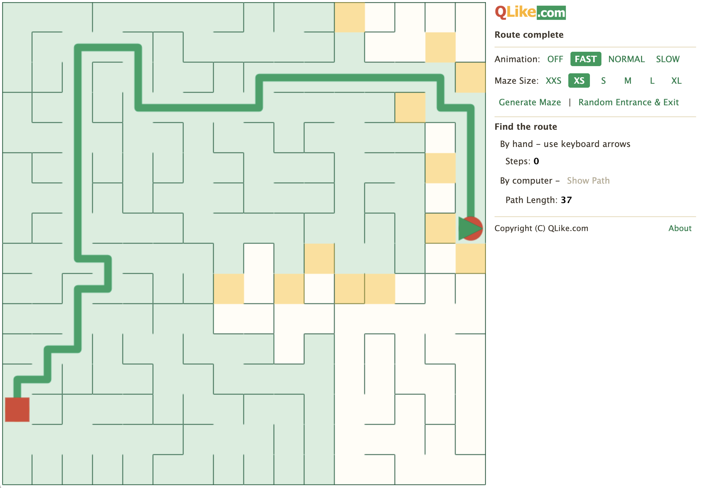

# Maze

A JavaScript implementation of a **maze generation algorithm** and **A\* path finding**, rendered on an HTML5 canvas. It has no dependencies and runs directly in the browser.

## Demo
https://www.qlike.com/maze/



## How it works

### Maze generation (randomized Prim's algorithm)

The maze is a grid of cells. Every pair of adjacent cells is separated by a wall, and at the start all walls are closed. Generation carves passages until every cell is reachable:

1. Pick a random cell, mark it as connected, and add its walls to a candidate list.
2. Pick a random wall from the list.
   - If the cells on both sides are already connected, discard the wall. Opening it would create a loop.
   - Otherwise open the wall, mark the new cell as connected, and add that cell's closed walls to the list.
3. Repeat until the list is empty.

The result is a *perfect maze*: no loops and no isolated areas, so exactly one route exists between any two cells.

### Path finding (A\*)

A\* searches from the entrance to the exit by always expanding the most promising node. Each node has a score `F = G + H`:

- `G` is the cost of the path from the entrance to the node (10 per step).
- `H` is the heuristic, the straight-line distance from the node to the exit.

The algorithm keeps two sets:

- **Open area** - discovered nodes waiting to be expanded.
- **Closed area** - nodes that have already been expanded.

Each step takes the open node with the smallest `F`, moves it to the closed area, and adds its reachable neighbours (those not behind a wall) to the open area. If a neighbour is already open and the new route to it is cheaper, its parent is updated. The search ends when the exit is reached, and the route is rebuilt by following the parent links back to the entrance.

With animation turned on, the open and closed areas are drawn on the canvas, so you can watch the search spread out.

## Architecture

```
src/
  common.js           Explicit helpers (random numbers, DOM, storage and canvas)
  astar.js            AStar: reusable A* search, no maze or drawing knowledge
  toolbar.js          Shared toolbar controls and option groups
  game-host.js        GameHost: canvas, resizing, input dispatch and game lifecycle
  app.js              Application startup and game registration
  web.css             Toolbar styles
  maze/
    maze-config.js    Maze defaults, colours and animation delays
    maze.js           Maze, Cell and Wall: grid model, generation and drawing
    maze-path.js      MazePath: maze-to-AStar adapter, player movement and drawing
    maze-game.js      MazeGame: toolbar, state machine, movement and maze rendering
  snake-plugin/       Optional Snake game, documentation and tests
release/      Minified build served on GitHub Pages
```

- **Maze** only knows the grid. It reports progress through the callbacks `onUpdateUI` and `onInitComplete`.
- **MazePath** runs A* directly on the maze cells (neighbours are the cells on the other side of an open wall), and reports through `onUpdateUI` and `onPathComplete`.
- **MazeGame** owns both. It wires up their callbacks, draws the maze and path, and drives everything through a small state machine: `Setup` → `Generating` → `Playing` → `Solving` → `Finished`. The toolbar buttons are enabled or disabled according to the current state.
- **Toolbar** creates the shared controls, option groups and selection/disabled states used by Maze and Snake.
- **GameHost** owns the canvas, background, logo, command palette, resizing and input listeners. It starts a game by constructing it with the host and calling `init()`. A game supplies `getGridSize()`, `draw(context, cellSize)`, `handleInput(event)`, `suspendInput()` and `destroy()`. The host blocks game input while a host-managed modal is open and reserves interactive controls' shortcuts, while allowing arrow keys on buttons to steer. The board can receive keyboard focus for game shortcuts. `suspendInput()` releases held input when a modal opens. Starting another game destroys the previous one and rebuilds the host's contents; games must cancel their timers and remove any listeners they own in `destroy()`. Games can use `host.toolbar` for their controls, `host.canvas` for pointer capture, and request a redraw or resize using the host.
- **MazeConfig** holds Maze's sizes, defaults, colours and animation options. Each Maze instance owns its current animation delays. Snake keeps its own settings, while the host owns canvas settings.

Double-click the logo to open the command palette. Enter `maze` to start a new maze; Escape or Cancel closes the palette without switching games. Games register with `registerGame(command, GameClass)` before the page's load event; unknown commands are not executed.

The URL fragment selects the game (for example, `#snake` or `#maze`). Refreshing or using browser navigation starts the selected game from scratch. Unknown or unavailable games are reported in the command palette.

## Build

The release files are the source files concatenated and minified. Node.js is required:

```
npm install
npm run build
```

To include the Snake plugin:

```
npm run build:snake
```

This appends the Snake files after the host; `npm run build` alone produces the normal Maze-only build. The build script also accepts optional plugin files in dependency order. Only include trusted code: it runs with the same page privileges as Maze.

The source page uses ordered classic scripts so it also works directly with `file://`; games register with the shared `registerGame` function before the page loads.

This writes `release/app.min.js`, `release/app.min.css`, `release/index.html` (from `src/index_release.html`) and `release/static/`. The `version` in `package.json` is added to the JS and CSS URLs as `?v=<version>`, so bump it for each release to refresh browser caches.

## Test

```
npm test
```

Runs the Maze and Snake tests with Node's built-in test runner (Node 18 or later, no extra dependencies). They check maze generation, A* routes, host lifecycle, cancellation of animated work, and Snake rules.

## Run locally

```
npm run serve
```

Then open http://localhost:8123/release/index.html (or `src/index.html` for the unminified sources).

The unminified source page includes Snake directly; the release build includes it only when the plugin files are passed to the build command above.

The release page skips Google Analytics on localhost, loopback addresses, and file URLs. Other hosts, including LAN addresses, still load it.

## AI assistants

See [AGENTS.md](AGENTS.md) for guidance on testing and releasing.

## License

MIT
