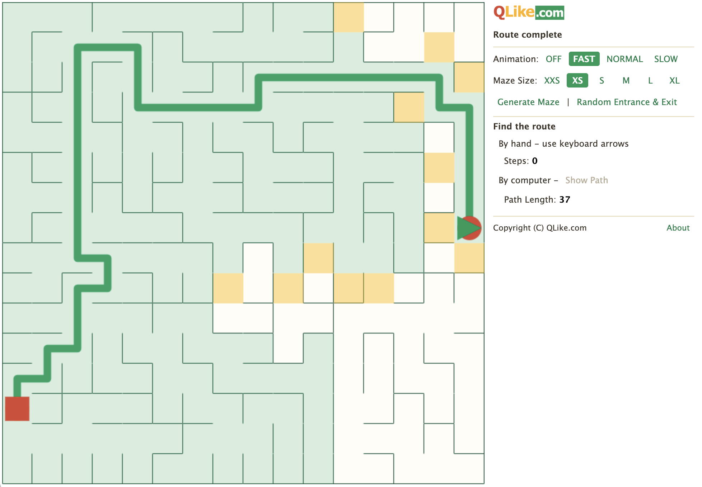

# Maze

A JavaScript implementation of a **maze generation algorithm** and **A\* path finding**, rendered on an HTML5 canvas. It has no dependencies and runs directly in the browser.

## Demo
https://www.qlike.com/maze/



## How it works

### Maze generation (randomized Prim's algorithm)

The maze is a grid of cells. Every pair of adjacent cells is separated by a wall, and at the start all walls are closed. Generation carves passages until every cell is reachable:

1. Pick a random cell, mark it as connected, and add its walls to a candidate list.
2. Pick a random wall from the list.
   - If the cells on both sides are already connected, discard the wall. Opening it would create a loop.
   - Otherwise open the wall, mark the new cell as connected, and add that cell's closed walls to the list.
3. Repeat until the list is empty.

The result is a *perfect maze*: no loops and no isolated areas, so exactly one route exists between any two cells.

### Path finding (A\*)

A\* searches from the entrance to the exit by always expanding the most promising node. Each node has a score `F = G + H`:

- `G` is the cost of the path from the entrance to the node (10 per step).
- `H` is the heuristic, the straight-line distance from the node to the exit.

The algorithm keeps two sets:

- **Open area** - discovered nodes waiting to be expanded.
- **Closed area** - nodes that have already been expanded.

Each step takes the open node with the smallest `F`, moves it to the closed area, and adds its reachable neighbours (those not behind a wall) to the open area. If a neighbour is already open and the new route to it is cheaper, its parent is updated. The search ends when the exit is reached, and the route is rebuilt by following the parent links back to the entrance.

With animation turned on, the open and closed areas are drawn on the canvas, so you can watch the search spread out.

## Architecture

```
src/
  common.js   Helpers (random numbers, DOM and canvas utilities)
  config.js   Sizes, colours and animation delays
  maze.js     Maze, Cell and Wall: grid model, generation and drawing
  astar.js    AStar: reusable A* search, no maze or drawing knowledge
  path.js     Path and AStarNode: player movement and drawing
  game.js     Game: toolbar, state machine, keyboard input and canvas
  web.css     Toolbar styles
release/      Minified build served on GitHub Pages
```

- **Maze** only knows the grid. It reports progress through the callbacks `onUpdateUI` and `onInitComplete`.
- **Path** builds its node graph from the maze's open walls, and reports through `onUpdateUI` and `onPathComplete`.
- **Game** owns both. It wires up the callbacks, draws the background, maze and path to the canvas, and drives everything through a small state machine: `Setup` → `Generating` → `Playing` → `Solving` → `Finished`. The toolbar buttons are enabled or disabled according to the current state.
- **Config** holds all the tunable values, so sizes, colours and delays are changed in one place.

## Build

The release files are the source files concatenated and minified. Node.js is required:

```
npm install
npm run build
```

This writes `release/app.min.js`, `release/app.min.css`, `release/index.html` (from `src/index_release.html`) and `release/static/`. The `version` in `package.json` is added to the JS and CSS URLs as `?v=<version>`, so bump it for each release to refresh browser caches.

## Test

```
npm test
```

Runs the maze generation and A* tests in `test/` with Node's built-in test runner (Node 18 or later, no extra dependencies). They check that generated mazes are perfect (fully connected, no loops) for square and non-square sizes, and that A* returns a valid route.

## Run locally

```
npm run serve
```

Then open http://localhost:8123/release/index.html (or `src/index.html` for the unminified sources).

## AI assistants

See [AGENTS.md](AGENTS.md) for guidance on testing and releasing.

## License

MIT
